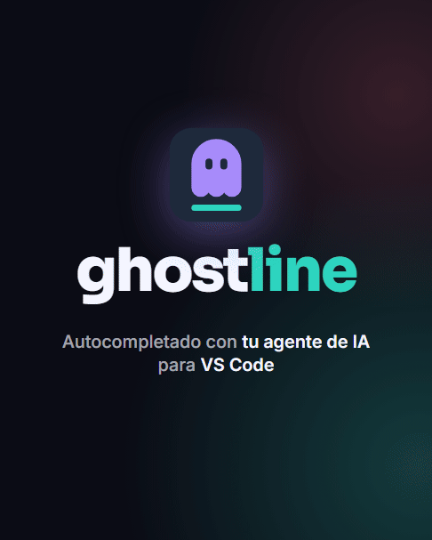

<p align="center">
  
</p>

<h1 align="center">ghostline</h1>

Autocompletado inline (texto fantasma) para VS Code con tu agente de IA. No trae modelo ni servidor
propios: lanza la herramienta de línea de comandos que ya tienes instalada, con la sesión o la clave que
tengas configurada en ella.

De momento funciona con un solo agente: la CLI de [Claude Code](https://claude.com/claude-code).

<p align="center">
  
</p>

## Requisitos

- VS Code 1.144 o posterior.
- Claude Code instalado y autenticado.

No hay nada más que configurar: ghostline usa la sesión que ya tenga la CLI, sea la de tu plan o una API
key (con API key, cada sugerencia se factura por uso y la barra de estado muestra lo gastado).

## Instalación

```
npm install
npm run package
code --install-extension ghostline-0.14.0.vsix
```

Si la barra de estado dice «sin CLI», pon en `ghostline.cliPath` la ruta del ejecutable (lo que devuelva
`which claude` o `where claude`).

## Uso

- Escribe y para un momento: la sugerencia aparece en gris. `Tab` la acepta, `Esc` la descarta.
- `Alt+\` (`Alt+ç` en teclado español) la pide a mano.
- **Correcciones**: cuando el compilador marca errores junto al cursor, ghostline propone el bloque corregido
  encima del código. `Tab` lo aplica, `Esc` lo descarta.
- **Barra de estado**: junto al fantasma, lo que llevas de tu tope diario y lo que ha gastado ghostline.
  Al pasar el ratón, el detalle; con un clic, pausar, cambiar de modo, ver el consumo, el log y las últimas
  sugerencias.

## Cómo funciona por debajo

1. **Cuándo pide.** Al dejar de teclear (600 ms por defecto), al final de una línea o justo donde acabas de
   escribir. Si sigues tecleando lo mismo que el modelo está respondiendo, la petición en curso se aprovecha
   en vez de lanzar otra.
2. **Qué envía.** Un prompt pequeño: unos 2.000 tokens con el código alrededor del cursor y la declaración
   de los símbolos que estás usando (se la pide al servidor de lenguaje del editor), más un índice de lo que
   declara tu proyecto (hasta unos 5.000, que se quedan en caché entre peticiones). El índice lo construye
   ghostline leyendo tus archivos; el modelo no lee nada por su cuenta.
3. **Cómo lo pide.** Lanza la CLI de tu agente en modo no interactivo, un proceso por sugerencia y otro ya
   arrancado esperando la siguiente, para no pagar el arranque. Va sin herramientas, sin servidores MCP,
   sin comandos ni sesión guardada, y en una carpeta vacía: solo puede devolver texto.
4. **Qué hace con la respuesta.** La limpia antes de enseñarla: quita explicaciones y marcas de formato,
   ajusta la sangría a la de tu archivo, descarta lo que repite lo que ya hay después del cursor y no
   muestra nada si el modelo duda.
5. **Qué recuerda.** Solo en tu equipo: las peticiones, los tokens y el coste del día, lo aceptado y lo
   ignorado (para dejar de sugerir donde nunca aceptas) y las últimas 40 sugerencias de cada proyecto.

## Ajustes principales

| Ajuste | Por defecto | |
|---|---|---|
| `ghostline.model` | `sonnet` | `haiku` gasta unas 12 veces menos por petición, pero tarda más. |
| `ghostline.triggerMode` | `auto` | `manual`: solo sugiere con el atajo. |
| `ghostline.debounceMs` | `600` | Pausa al teclear antes de pedir una sugerencia. |
| `ghostline.dailyRequestLimit` | `1500` | Tope de peticiones al día. |
| `ghostline.context.symbols` | `true` | Enviar también declaraciones de otros archivos del proyecto. |
| `ghostline.corrections` | `true` | Proponer correcciones. |
| `ghostline.excludePatterns` | `.env`, claves… | Archivos de los que nunca se envía nada. |

El resto está en *Ajustes → ghostline → Avanzado*.

## Privacidad y seguridad

- **Qué se envía al proveedor de tu agente** (lo envía su CLI): hasta 60 líneas antes y 20 después del
  cursor y, con `ghostline.context.symbols`, nombres y tipos declarados en otros archivos del proyecto.
  Nunca valores ni cuerpos de función.
- **Qué no se envía nunca**: los archivos excluidos (`.env`, claves, credenciales…). Un repositorio puede
  añadir exclusiones, no quitarlas.
- **Credenciales**: ghostline no lee, guarda ni transmite tu sesión ni tus claves; solo las usa la CLI de tu
  agente. No tiene servidor, telemetría ni conexiones de red propias.
- La CLI se lanza sin shell, sin herramientas (el modelo no puede leer, editar ni ejecutar nada) y en una
  carpeta vacía propia, nunca en tu proyecto: un repositorio no puede cambiar qué se ejecuta ni a dónde van
  las peticiones.
- Solo funciona en áreas de trabajo de confianza.
- En tu equipo quedan, dentro del almacenamiento de VS Code, los contadores de uso y las últimas 40
  sugerencias de cada proyecto.

El detalle, y cómo avisar de un fallo de seguridad, en `SECURITY.md`.

## Sobre el proyecto

ghostline es un proyecto independiente, sin relación con Anthropic («Claude» y «Claude Code» son marcas
suyas). No da acceso a ningún servicio de IA: ejecuta en tu equipo la herramienta que tú has instalado,
con tu cuenta, así que su uso sigue las condiciones de tu proveedor.

## Desarrollo

```
npm run check      # tipos, lint y tests (CLI simulada: no gasta tokens)
npm run test:e2e   # VS Code real en un perfil aislado, con la CLI simulada
npm run package    # genera el .vsix
```

Sin dependencias de runtime. Licencia [MIT](LICENSE).
